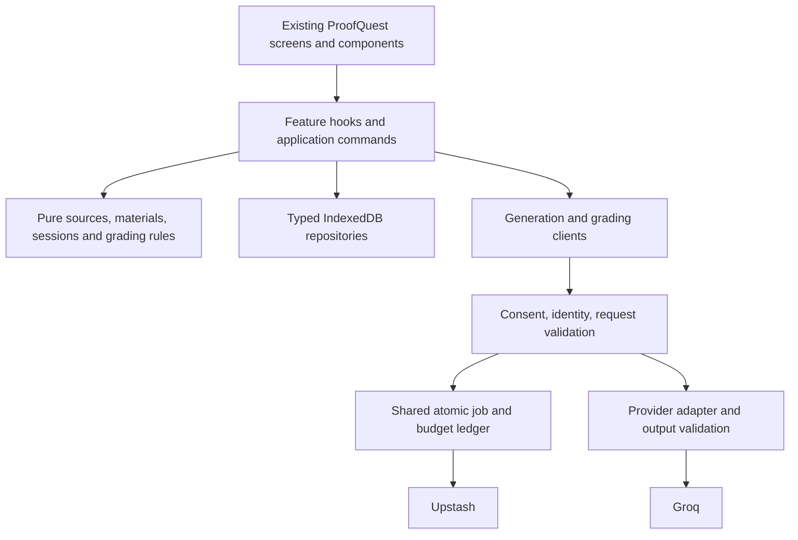

# ProofQuest study-feature expansion architecture

Owner: Maur1k. Prepared: 2026-11-17. Status: proposal for review, not implementation authorization.

## Intent and constraints

Adapt the supplied Gemini prototype's useful study features inside ProofQuest's existing UI/UX. Preserve branding, artwork, tokens, AppShell, navigation, responsive components, guest access and current routes. Do not port the standalone HTML or replace the application with StudyForge. Improve task continuity within existing screens; no visual redesign is included.

Requested direction: PDF and pasted-text sources, labeled sample content, flashcard bookmarks, mixed quizzes, written exams, optional timing, AI feedback, and format switching. Retain Reviewer and all existing saved content. This proposal expands the earlier MCQ-only/no-timer scope for new sessions; it does not retroactively change it for saved sessions.

Planning assumptions: personal self-study, no login requirement, no authoritative academic grading, local-first persistence, free-service preference, no paid billing, no push or publication. PDF extraction and objective grading remain local. AI is used for material generation and optional written-answer feedback only. No OCR, vision, cloud account sync or collaborative exams in this change.

## Current baseline and blocking evidence

- React/TypeScript/TanStack Start application; pure domain logic in `src/domain`, transactional repositories in `src/data`, one application context in `src/store`, UI in `src/features`.
- PDF records/pages, immutable quiz versions, revisioned Practice/Test sessions, immutable reviewer/deck records and separate deck progress already exist.
- IndexedDB database name is `proofquest:data:v2`, currently schema version 2. Backup format is version 3 and imports version 2. Database name is not the schema version and must not change during upgrades.
- Server-only Groq adapter and Upstash reservations exist locally. Consent, signed guests, origins, response bounds, cached retries and reload recovery are implemented. Generation is disabled after the quality failure.
- Browser review found a two-valid-answer MCQ incorrectly graded, an ambiguous all-of-the-above item and a Reviewer provider failure. See `phase-6-browser-quality-review.md`. These block enabling new AI features; successful JSON parsing is not evidence of educational quality.

## Architecture and dependency direction

Keep one app context as the public command/state boundary, with feature-specific hooks and internal application services. Do not grow one component or reducer into the implementation of every feature. Domain code must not import React, IndexedDB or provider SDKs. Repositories must not call AI inside transactions. UI never decides scores or synthesizes fallback results.

Suggested modules, introduced only when their phase needs them:

| Module | Responsibility |
|---|---|
| `domain/study-source.ts` | Source revisions, segments, citations, selection fingerprints |
| `domain/study-content.ts` | Versioned material/question unions, stable item identities |
| `domain/answer-policy.ts` | Deterministic blank-answer matching, normalization versions |
| `domain/written-exam.ts` | Written attempts, submission snapshots, rubric/feedback contracts |
| `domain/session-timing.ts` | Pure deadline and expiration transitions |
| `domain/generation-quality.ts` | Structural quality rules and review findings, not a truth oracle |
| `features/study-sources/` | Pasted text and source selection integrated into existing library |
| `features/quizzes/` | Extend existing renderers with typed adapters |
| `features/written-exams/` | Written drafts, submit, pending feedback and results |
| `server/grading/` | Bounded, consented written grading with shared ledger |
| `data/` repositories | Schema migrations, atomic saves, backups and conflicts |

## 1. Sources: PDF, pasted text and samples

Introduce a discriminated `StudySource` with stable ID, kind (`pdf`, `text`, `sample`), title and immutable revision ID. A revision holds content hash, creation time and ordered segments. Each segment has a stable ID and text; PDF segments also carry their real page number and document ID. Text segments use paragraph/section labels. Never manufacture PDF page numbers for pasted text.

PDF source adapters reference existing document/page records without duplicating PDF blobs. Text editing creates a new revision; it never alters source snapshots inside saved materials. Original PDF preview remains available. Deleting a source leaves retained excerpts and historical results intact, with a missing-original indication.

New evidence references are a union of PDF page references and text/sample segment references, bound to a revision and exact excerpt. Legacy `documentId/page/excerpt` citations retain their current reader. Stable fingerprints include source revision, ordered selection, format, question specification and prompt/contract versions.

Keep selection, extracted-text review and transfer consent in the existing generation panel. Display actual selected coverage; never silently truncate to the first 15,000 characters as the prototype does. Large files continue through bounded selected-page extraction; increasing file limits is a separate measured acceptance task.

Sample data stays explicitly labeled and requires no AI call. Preserve the existing isolated programming demo. Add subject-neutral fixtures through an adapter; saving a sample must be an explicit action that records sample provenance. Errors never trigger a sample substitute.

## 2. Content contracts and saved-material reuse

Add versioned new-content contracts rather than widening every legacy strict schema in place. An immutable material envelope contains schema version, ID, source snapshot, generation metadata, material kind and typed content. Generation metadata records provider/model, prompt version, validation version and review status. A structural pass is labeled as such; do not label it verified knowledge.

- MCQ: stable question/option IDs, exactly one keyed option, explanation and evidence. Reject duplicated/equivalent options and all/none-of-the-above in newly generated batches. Lexical checks cannot detect all semantically overlapping answers.
- Fill-in-the-blank: one explicit blank, canonical answer, reviewed accepted variants, normalization policy and evidence. Avoid multiple blanks, vague questions and unbounded answer vocabularies initially.
- Flashcard: stable card ID, front/back, evidence. Bookmarks reference card IDs, not mutable positions. Bookmarks, reveal and navigation state are separate revisioned progress records; no pretend bookmark toast.
- Reviewer: preserve source-linked sections, terms and comparison rows; optional content stays empty when unsupported.
- Written question: prompt, source evidence, explicit analytic rubric with bounded criterion points, reference answer and word/character guidance. Separate short-answer and essay types.

Quiz and objective Exam share the same immutable question set and local grading. Mixed quizzes default to five questions total; propose 3 MCQ + 2 blanks when the source supports them. Do not pad an insufficient source with invented questions. Existing five-MCQ versions remain five-MCQ versions.

Keep the four visible choices: Flashcards, Quiz, Exam and Reviewer. Exam gains a subtype control within the existing panel: Objective (default) or Written. Switching Quiz ↔ Objective Exam reuses questions. Switching to another content format opens a compatible saved material or asks to generate it, with a fresh consent/allowance disclosure. Merely switching a view never spends an AI allowance.

## 3. Objective grading and results

Extend the existing discriminated question/response rendering through exhaustive type switches. Preserve internal `practice` and `test` modes. Keep legacy grading and completed result snapshots unchanged.

New mixed sessions use a new grading-policy version. Blank answers are graded locally using explicit accepted variants and conservative whitespace/Unicode normalization. Case sensitivity is per question; do not indiscriminately normalize units, mathematical notation, punctuation or accents. No fuzzy matching or live AI call on every answer. Show the accepted answer when feedback is permitted and offer a report-problem action for restrictive or ambiguous items.

Continue one saved submission per Practice question and editable Test drafts before submission. Score each objective question once. Repeated clicks, reopening and format switching cannot increment scores. Completed results remain immutable; restarting creates a new attempt. A report/flag never silently changes historical grades.

## 4. Written exams and AI feedback

Use a separate written-attempt contract and repository so asynchronous partial-credit feedback cannot corrupt objective `QuizScore` records. Link both through typed history entries, not a second global store.

State transitions:

`draft → submitted → feedback-pending → feedback-ready`

`feedback-pending → feedback-failed → retry same feedback job`

Store answer drafts locally with revisions and visible saving/error states. Submission atomically freezes answers, question/rubric/source snapshots and timing metadata before network activity. Editing after submission requires a new attempt. Submission can finish offline; AI feedback remains pending until the user requests it online.

Grading has its own explicit consent because it transfers student answers as well as source excerpts and rubrics. Send no PDF file or unnecessary filename. Require bounded student text and rubric/source snapshots, schema validation and evidence for feedback. Treat answers and client-supplied rubrics as untrusted data, never instructions. These are editable self-study inputs, not a secure examination authority.

Feedback includes criterion scores, criterion maxima, grounded reasoning and actionable suggestions. The server validates IDs, complete coverage, finite in-range points and totals; the domain calculates the total rather than trusting a model-provided percentage. Zero stays zero. Unsupported/ungradable output yields an ungraded/pending state, never 16/20, generic praise or a fabricated model answer.

Initial delivery: short-answer exams behind a separate capability, with five questions only if the measured input/output budget fits. Prefer one bounded grading call for a submitted short-answer batch. If source + rubrics + answers cannot fit, reject before reserving allowance and offer a smaller exam; never truncate. Essay support remains independently disabled until its longer-context budget and quality have been demonstrated. No automatic per-question fan-out. A future multi-call grader requires atomic aggregate reservations, per-part idempotency and explicit partial/ungraded results before introduction.

Assessment limits: show “AI feedback for self-study,” retain explanations and allow issue reporting. A second model pass is a useful rejection signal but cannot establish correctness. Rubrics and human-reviewed evaluation fixtures are required before enabling this capability.

## 5. Optional timing

Untimed remains the default for new objective and written exams. The chosen duration becomes immutable when the attempt starts. Persist `startedAt`, duration and absolute `deadlineAt`; derive remaining time from the clock, never from interval decrement counts. Reload/backgrounding must not restart or pause the deadline.

On expiration, one idempotent local transition locks the latest durably saved answers. Retry failed storage transitions with a visible failure state; do not falsely claim submission. Written feedback is a separate online step and never starts without its consent. Unsaved answers and multi-tab conflicts need explicit recovery handling. A browser clock is not tamper-proof: this is a study timer, not proctoring. Support untimed use and accessible warnings; avoid forced animation and excessive announcements.

## 6. AI jobs, budgets and quality controls

Reuse the current server boundary, fixed-error responses and shared Upstash ledger. Add operation kind (`generate-material`, `grade-written`) and contract versions to request fingerprints. Idempotency includes the immutable submission hash for grading. Cached completion cannot be overwritten by a later failure, and stale responses must never attach to a changed draft.

Capabilities become granular: generation formats, mixed-question generation, written generation, written grading and timer UI. General enablement alone must not unlock unvalidated modes. `/api/generation/config` can evolve through an explicitly versioned response; keep old clients fail-closed. Add a grading endpoint with the same origin/guest protections and separate consent version.

Current initial limits are 3 guest requests/day, 20 global/day, a 65-second shared interval, 3,500 input bytes and 2,500 completion tokens. Treat these as constraints to measure against, not capacity for essays. Generation and grading share the global budget; advertise that written feedback is a separate operation and may wait for allowance reset. Never automatically increase limits or enable paid fallback to finish an exam.

Before complex workloads, evolve reservation accounting to validated input/output token ceilings per operation, while retaining request caps and provider pacing. Atomic scripts enforce guest/global limits across primary and backup hosts. Reserve before every external call, including any verifier; keep conservative failure accounting. Disclose all provider/verification calls and their budget implications. Free availability is best-effort, not guaranteed concurrency or unlimited use.

Quality pipeline: bounded extraction → evidence-preserving generation → strict schema/citation checks → deterministic duplicate/choice/rubric checks → optional budgeted semantic review → rejection or saved material. Do not silently auto-regenerate failed material. Maintain structured issue reports without logging private source text in production.

Acceptance corpus: public/licensed material spanning biology, history and technical material; clean text, broken extraction, qualifiers, list-based ambiguities, missing evidence, image-dependent questions and embedded hostile instructions. Proposed release gate: at least 30 manually audited MCQs and 20 blanks across three subject areas, with zero known multi-correct or wrongly keyed items in the accepted corpus; all sampled reviewer/card claims supported. This is a regression gate, not a statistical accuracy claim. Written grading uses human-scored rubric fixtures including empty answers, partially correct answers, contradictions and instruction injection; define tolerance before live evaluation and reject high-impact disagreements.

## 7. Persistence, migration and recovery

Use additive IndexedDB upgrades in the existing database. Keep legacy stores and readers intact. First schema upgrade adds source revisions, new material records and bookmark progress as needed; later written-attempt/feedback stores get a subsequent schema upgrade when shipped. Do not allocate unused stores for unimplemented features. Assign actual version numbers at each migration checkpoint after checking the repository baseline.

New backup format version 4 must discriminate old/new records and include new stores, references and progress. Continue importing v2/v3 through explicit transforms; old applications must reject unsupported v4 rather than partially importing it. Validate the complete import and cross-record references before atomic merge. Preserve source conflicts and legacy rollback snapshots. Later additions requiring schema changes receive another explicit backup version rather than invisible format drift.

Material content and completed attempts are immutable; progress/drafts use optimistic revision checks. Retain source snapshots for review after original deletion. Cache expiration only removes server retry results, not local documents or grades. Explain that deleting browser data does not instantly erase provider logs or existing TTL-bound server cache entries.

Rollback means disabling a new capability and returning to supported screens; do not attempt an IndexedDB downgrade. A prior build must not write incompatible new records. Test blocked upgrades, multiple tabs, quota failures, interrupted writes, exports and imports before release.

## 8. Delivery phases and approval gates

Do not renumber or declare completion of historical phases. Treat these as proposed Phase 6 expansion milestones; Phase 7 remains the release/recovery phase. Obtain Sir's confirmation before starting each milestone and stop with evidence at its end. The present request authorizes this planning document only.

| Milestone | Deliverable | Exit criteria |
|---|---|---|
| 6A — Restore trustworthy generation | Fix current MCQ ambiguity handling and Reviewer reliability; establish quality fixtures and capability gates | Reproduce known defects; reject ambiguous output; audit accepted samples; demonstrate existing PDF-to-results and reviewer/card paths. AI stays disabled until its relevant acceptance passes. |
| 6B — Unified sources | PDF adapter, pasted text, labeled samples, revisioned citations and safe migration | Text/PDF → preview → consent → selected format; old source links and history work; v2/v3 backups migrate and new backups round-trip. |
| 6C — Flashcards and reuse | Durable bookmarks, bookmarked-only review and explicit saved-format reuse | Keyboard/touch reveal; bookmarks survive reload/export; switching compatible modes makes no AI call; sample isolation preserved. |
| 6D — Mixed objective quizzes | MCQ + single-blank questions in Quiz and Objective Exam | Deterministic matching cases; no double scoring; deferred Exam feedback; legacy scores unchanged; reviewed source-supported batches. |
| 6E — Written short-answer exams | Rubrics, durable drafts, immutable submission, resumable AI feedback | Rubric/score range validation, zero scores, offline submit, failed grading recovery, quota/cost envelope and human-scored fixture acceptance. |
| 6F — Optional timing and essays | Persisted study timers; essays only after separate context/quality validation | Background/reload/expiry/write-failure tests; accessible untimed option; no grading call without consent; bounded essay evaluations. Can split into timer and essay approvals. |
| 6G — Integrated expansion acceptance | Existing ProofQuest UI/UX with all approved capabilities | End-to-end source → each format → result/history → reload/backup; keyboard and 320/390/768/1024/1440 widths; no regressions to legacy quests; limitations recorded. |

Phase 7 then verifies actual hosting, device scope, recovery and an authorized release. No milestone grants push, publication, provider spending or domain-change permission.

## Decisions at implementation checkpoints

- Before 6A: approve the quality corpus/gate and whether a bounded semantic verifier is worth the extra free-tier usage. Default: deterministic checks plus human evaluation; generation remains off if those are insufficient.
- Before 6D: approve the proposed 3 MCQ + 2 blank default and accepted-answer policy.
- Before 6E: approve the measured written batch size/answer limits and rubric-scoring tolerance. If free capacity cannot support it, deliver local written practice with reference answers before live AI feedback rather than pretending the service can grade it.
- Before 6F: approve timer duration presets and essay scope; neither is inferred from the prototype's hard-coded 15 minutes.

No new infrastructure or state-management framework is needed for these milestones. Extend the current tested boundaries, keep features independently releasable, and measure the provider limits before promising larger workloads.
